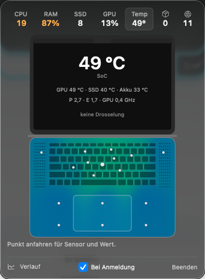

# hogwatch

A small menu bar app for Apple Silicon Macs that shows what is eating your machine — CPU, memory,
SSD, GPU, temperature, Docker and open ports — and tells you when it gets critical, naming the
process behind it.



It exists because a Mac once crawled along at a load average of 200: parallel test runs, Spotlight
and two headless Chromiums left behind by Playwright that had been burning CPU for 15 days. Activity
Monitor shows all of that, but only if you go and look. hogwatch puts the load in the menu bar,
flags **orphaned processes** (busy processes whose parent is gone) and sends a notification before
the machine becomes unusable.

- No dependencies, no Xcode project, no root. One `swiftc` call builds it.
- Reads everything the system offers without privileges, including temperatures, clock speeds and
  SSD health through private Apple interfaces (see [Limitations](#limitations)).
- The user interface is in German.

## Requirements

- Mac with Apple Silicon, macOS 15 or later
- Xcode or the Xcode command line tools (Swift 6)

## Build and run

```sh
git clone https://github.com/andrehickmann/hogwatch.git
cd hogwatch
./build.sh install   # builds, copies Hogwatch.app to ~/Applications and starts it
```

Other targets:

```sh
./build.sh           # build only: build/Hogwatch.app
./build.sh test      # self-check of the parsing and alert logic
```

The app is signed ad hoc on your machine, so Gatekeeper does not get in the way. On first start
macOS asks whether hogwatch may send notifications — allow it.
`~/Applications/Hogwatch.app/Contents/MacOS/hogwatch --demo-alert` posts a test notification.
"Bei Anmeldung" in the panel starts it at login.

If the icon does not appear: on a MacBook with a notch, menu bar icons that do not fit are hidden
behind it. Cmd-drag other icons out of the menu bar to make room.

## What it shows

| Tab | Content |
| --- | --- |
| CPU | load average, clock of performance/efficiency cores, top processes with origin (tool and working directory) |
| RAM | used memory split into apps, wired and compressed; pressure, swap; top processes by footprint (like Activity Monitor), VMs and XPC services named after their app |
| SSD | health from NVMe SMART (wear, spare, media errors, TB written, written today), read/write MB/s, IOPS, top processes by disk IO (own processes only) |
| GPU | utilisation, clock, top processes |
| Temp | MacBook Pro 14" (M1 Pro) drawing with a heat map of the sensors; other Macs get a list. Throttling and low power mode |
| Docker | running containers with CPU, uptime, ports; stop button. The tab shows the container count |
| Ports | listening TCP ports of own processes (count in the tab, read every 10 s while the panel is open). Web servers open in the browser, others copy `localhost:<port>`; stop the process or container |

Above the tabs, a red banner lists **orphaned processes**: own processes whose parent died
(re-parented to launchd), that are no regular app, and that used more than 50 % CPU on average over
10 minutes. "Beenden" sends SIGTERM to the process and its children, SIGKILL after 3 s.
"Ignorieren" remembers the executable and tool.

The menu bar shows the 1-minute load; the background turns orange or red with the worst state
(load, memory pressure, throttling, orphans).

"Verlauf" opens a window with 15 minutes at 2 s resolution and 24 hours of minute averages,
kept in `~/Library/Application Support/hogwatch/history.jsonl`.

## Notifications

| When | Condition |
| --- | --- |
| Load critical | 1-min load ≥ 3 × cores for 2 min |
| Memory pressure | kernel level critical, or warning for 10 min |
| SSD | ≥ 200 MB/s or ≥ 3000 IOPS for 2 min |
| Throttling | thermal pressure moderate or worse for 1 min |
| Orphaned process | as described above, once per process |
| Container | ≥ 50 % CPU on average over 10 min, once per container |
| SSD health | controller reports a critical warning, spare below threshold or media errors |

Each alert fires at most every 15 minutes and only again after the value was back to normal.
Thresholds live in `Limits` in `Sources/Logic.swift`.

## Data sources

All readable without root:

- `ps` (setuid) for per-process CPU and memory — the only way to see root processes like `fseventsd`
- `proc_pid_rusage`, `KERN_PROCARGS2`, `proc_pidinfo` for disk IO, arguments and working directory (own processes)
- Mach `host_statistics`, `getloadavg`, sysctl (`vm.swapusage`, `kern.memorystatus_vm_pressure_level`)
- IOKit: `IOBlockStorageDriver` statistics, `IOAccelerator` utilisation and per-client GPU time
- Private APIs: `IOHIDEventSystemClient` (temperatures), `IOReport` (clock residencies), `com.apple.system.thermalpressurelevel`.
  If Apple removes them, those values show "–" and everything else keeps working.
- NVMe SMART log through the `NVMeSMARTLib` IOKit plug-in, read every 10 minutes
- Docker Engine API over the Unix socket (via `curl`), only while Docker Desktop's VM runs — any API call would wake it from Resource Saver
- `lsof` for listening ports

## Limitations

- **Private interfaces.** Temperatures (`IOHIDEventSystemClient`), clock speeds (`IOReport`) and
  the responsible-app lookup are not public API. A macOS update may break them; the app then shows
  "–" for those values and keeps working.
- **Without root**, per-process disk IO, arguments and working directory are only available for
  your own processes. IO of system daemons such as `fseventsd` or Spotlight cannot be attributed.
  Memory of other users' processes is resident memory only.
- **Heat map** is drawn for the MacBook Pro 14" with M1 Pro (`MacBookPro18,x`); other Macs get a
  plain list. Sensor positions are approximate — Apple publishes no sensor map.
- **Clock tables** are read from keys used by M1–M3 chips; later chips show "–" until their keys
  are added.
- **Docker** support targets Docker Desktop. Colima or OrbStack would need their own VM detection.

## Layout

```
Sources/Logic.swift        thresholds, parsers, sliding CPU window, alert gate (pure, tested)
Sources/Sensors.swift      sysctl, Mach, IOKit and private API readers
Sources/Sampler.swift      builds a snapshot: processes, Docker, ports
Sources/Monitor.swift      timer, history, alerts, actions, menu bar icon
Sources/Views.swift        panel, tabs, heat map
Sources/HistoryView.swift  history window
Sources/App.swift          app entry, notifications, --render dev aid
Tests/main.swift           self-check
```

`hogwatch --render <dir>` renders each tab to PNG and quits (development aid; scroll views stay empty).
